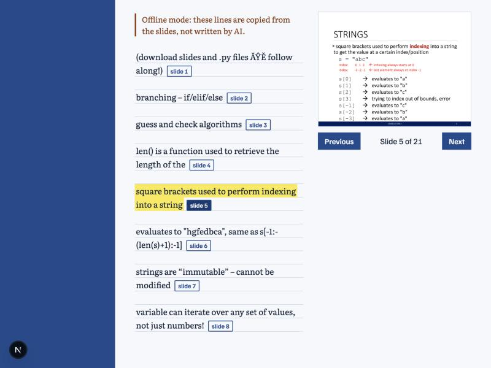
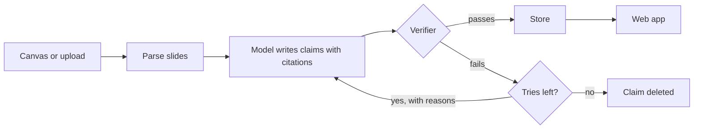

# Lecture Harness

[](https://github.com/Neo-Land/lecture-harness/actions/workflows/ci.yml)

Lecture notes where every claim is checked against the slide it cites. An AI writes the notes, plain code
fact-checks each one, and anything that still fails is deleted before you see it.



<sub>Shown in offline mode. Slide from MIT OpenCourseWare 6.0001, Fall 2016, CC BY-NC-SA.</sub>

New here? [How it works, in plain English](docs/HOW_IT_WORKS.md) and the [case study](docs/CASE_STUDY.md).



## Results so far

Offline run over 5 MIT lectures, with draft test sets. **The real model hasn't been run yet.**

| Verifier without the AI judge | Caught |
|---|---|
| Wrong numbers, wrong or invented slides, renamed terms | 29 / 29 |
| Errors of meaning (the AI judge's job, not yet measured) | 0 / 11 |
| True claims wrongly rejected | 0 / 18 |

Method and limits: [`docs/EVALS.md`](docs/EVALS.md).

## How accuracy is enforced

| Check | How | Catches |
|---|---|---|
| Citation | every claim cites slides that exist | invented slide references |
| Exact fact | numbers, `"quoted terms"`, and `` `code` `` must appear on the **cited** slide | wrong numbers, renamed functions, facts from the wrong slide |
| Judge | a second, cheaper model checks paraphrases against slide text | unsupported generalizations |

If a claim still fails after the revision budget, it's **dropped**, never shown.
Questions with no supporting slides return `insufficient_evidence: true` instead of a guess.

## Command line

```bash
python -m app ingest lecture7.pdf --course "CS 2"
python -m app ask "What is merge sort's worst case?" --course "CS 2"
python -m app sync      # pull new lectures from Canvas; see docs/CANVAS.md
```

Add `--offline` (or set `HARNESS_OFFLINE=true`) to run with no API key. Offline mode is not AI: it only
quotes lines from the slides. Logs go to stderr as JSON lines, so stdout stays clean.

Real-model check, which costs money: see [`docs/RESULTS.md`](docs/RESULTS.md).
Evaluation: `python -m evals.run` (offline, free), explained in [`docs/EVALS.md`](docs/EVALS.md).

## Web app

```bash
uvicorn app.api:app --reload       # terminal 1 (HARNESS_OFFLINE=true needs no API key)
cd web && npm install && npm run dev   # terminal 2, then open http://localhost:3000
```

After changing an API response, regenerate the frontend's types:
`python scripts/export_openapi.py && cd web && npm run gen:api`.

## Docker

```bash
docker compose up --build     # full app, reads optional .env, then open http://localhost:3000
```

Public demo setup: [`docs/DEPLOYMENT.md`](docs/DEPLOYMENT.md).

## Security

Secrets live only in `.env`, and real course files stay in the git-ignored `data/`. The public demo is
read-only, has no Canvas access, holds only open-license slides, needs no API key by default, and limits
questions per visitor and per day. There are no user accounts, so **don't expose the full app to the
internet**: anyone could upload files, spend your API budget, and read your courses.

## Layout

```
app/
  models.py     pydantic shapes (Slide, Deck, Claim, VisualSpec, Summary, Answer)
  parsing.py    PDF / PPTX -> numbered slides (incl. speaker notes and tables)
  verifier.py   citation, exact-fact, and judge checks
  llm.py        Claude via forced tool calls (always-valid JSON) + LLM judge
  harness.py    generate -> verify -> revise loop; question answering over retrieved slides
  retrieval.py  BM25 keyword search across a course's slides
  store.py      SQLite: decks, summaries, which LMS file versions are already processed
  pipeline.py   sync new/changed files and run them through the harness
  lms/canvas.py Canvas REST client (personal access token)
  api.py        FastAPI endpoints for the frontend
  __main__.py   command line (ingest, ask)
  logs.py       JSON-lines logging
  config.py     settings and startup validation
web/            Next.js frontend
evals/          accuracy measurement
tests/          runs offline with a scripted fake model
```

## Run

```bash
python -m venv .venv && source .venv/bin/activate
pip install -r requirements.txt -r requirements-dev.txt
cp .env.example .env            # add your Anthropic key; Canvas is optional
pytest --cov=app                # no API key needed
ruff check . && ruff format --check .
set -a; source .env; set +a
uvicorn app.api:app --reload    # http://localhost:8000/docs
```

| Endpoint | Purpose |
|---|---|
| `GET /health` | liveness check |
| `POST /upload` (form: `course`, `file`) | add a PDF/PPTX manually |
| `POST /sync` | pull new/changed files from Canvas |
| `GET /config` | which optional features are on |
| `GET /courses`, `GET /courses/{course}/decks` | browse |
| `GET /decks/{id}` | slides + verified summary + verification report |
| `GET /decks/{id}/slides/{n}` | one slide (for citation links) |
| `GET /decks/{id}/slides/{n}/image` | the slide as a PNG (PPTX needs LibreOffice installed) |
| `POST /ask` `{course, question}` | grounded answer with sources |

## Project docs

- [`docs/HOW_IT_WORKS.md`](docs/HOW_IT_WORKS.md) — plain-English explanation
- [`docs/CASE_STUDY.md`](docs/CASE_STUDY.md) — design, what failed, numbers
- [`CLAUDE.md`](CLAUDE.md) — rules for Claude Code in this repo
- [`docs/PROJECT_PLAN.md`](docs/PROJECT_PLAN.md) — phases, tasks, current status
- [`docs/CANVAS.md`](docs/CANVAS.md) — connecting Canvas
- [`docs/SETUP_ACCESS.md`](docs/SETUP_ACCESS.md) — setup and what access to grant
- [`docs/ARCHITECTURE.md`](docs/ARCHITECTURE.md) · [`docs/decisions/`](docs/decisions/) · [`CHANGELOG.md`](CHANGELOG.md)

> Course slides are usually your professors' copyrighted material. Keep real files local
> (`data/` is gitignored) and use open courseware (e.g. MIT OCW) for the public demo.
